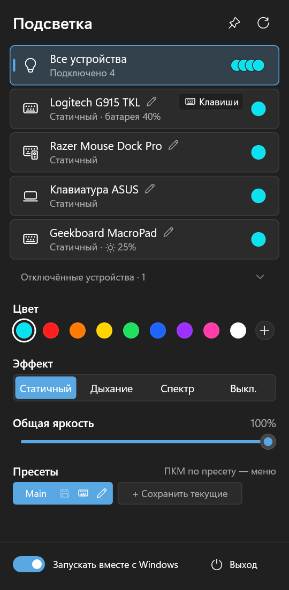
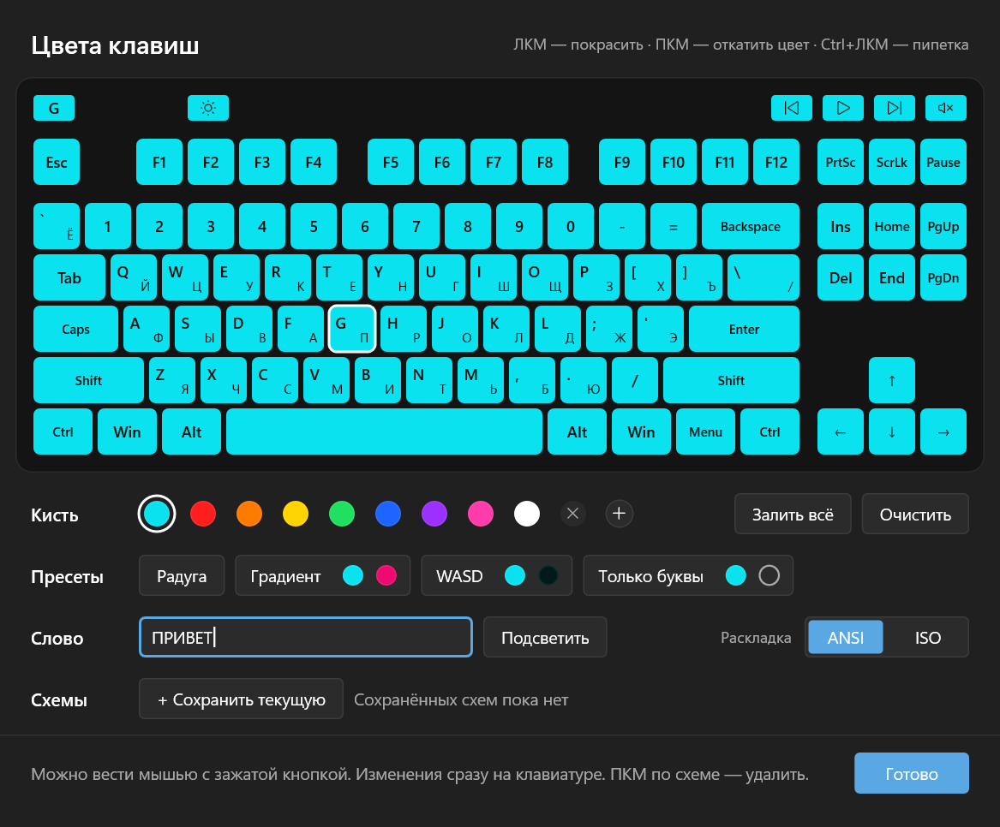

# RGB Tray

[English](README.md) · **Русский**

Маленькое приложение в трее Windows, которое управляет подсветкой клавиатур и мышей напрямую по HID — без фирменных программ (G HUB, Synapse, Armoury Crate, SignalRGB) в фоне.

<p>
  
  
</p>

## Поддерживаемые устройства

| Устройство | Подключение | Что работает |
|---|---|---|
| Logitech G915 TKL | Приёмник LIGHTSPEED | Статичный, дыхание, спектр, выкл.; цвета клавиш; батарея |
| Razer Naga V2 Pro | Донгл HyperSpeed / док | Раздельные зоны логотипа и колеса; эффекты; батарея |
| Razer Mouse Dock Pro | USB | Статичный, дыхание, спектр, выкл. |
| Ещё около 90 мышей, клавиатур и аксессуаров Razer (Basilisk, DeathAdder, Viper, Cobra, BlackWidow, Huntsman, Ornata, Firefly, Goliathus, Base Station…) по данным OpenRazer — [список](profiles) | USB / донгл | Статичный, дыхание, спектр, выкл.; зоны мышей; батарея. **Не проверены**: об этом написано в карточке, отзыв очень нужен. Беспроводные клавиатуры HyperSpeed пока только по кабелю. |
| Клавиатура ноутбука ASUS (Aura) | Встроенная | Статичный, дыхание, спектр, выкл.; зоны клавиатуры и лампы корпуса через LampArray |
| Geekboard MacroPad v2 (QMK/VIA) | USB | Статичный, дыхание, спектр, выкл. |
| Другие клавиатуры QMK с VIA и RGB (Keychron, самодельные…) | USB | Статичный, дыхание, спектр, выкл., яркость (дыхание и спектр рисует приложение) |
| Устройства со стандартом «Динамическое освещение» Windows (HID LampArray) | USB / встроенные | Статичный, дыхание, спектр, выкл., зоны из описания устройства (дыхание и спектр рисует приложение) |

Другие модели с теми же протоколами могут заработать, но не проверялись.

### Как попросить новое устройство

Правый клик по значку в трее → **Запросить поддержку устройства…**. RGB Tray соберёт список HID-устройств, отметит те, у которых может быть управляемая подсветка, скопирует отчёт в буфер обмена и откроет [форму запроса](../../issues/new?template=device-request.yml). Укажите модель и вставьте отчёт. Серийные номера в отчёте сокращены.

Устройство Razer часто можно добавить сразу, не дожидаясь новой версии: опишите его в небольшом файле профиля ([docs/profiles.ru.md](docs/profiles.ru.md)).

## Возможности

- Одна панель для всех устройств: цвет, эффект, яркость — сразу для всех или для одного.
- Общая яркость и яркость каждого устройства поверх неё.
- Скорость дыхания и спектра: общая и для каждого устройства.
- Эффекты прошивки сверх основных — в «Ещё»: волна и рябь от нажатий у Logitech G915, волна у клавиатур ноутбуков ASUS; профили Razer могут добавить волну, отклик на нажатия и звёзды.
- Цвета клавиш Logitech: кисть, пипетка, радуга, двухцветные градиент, WASD и «только буквы», подсветка слова, сохранённые схемы, раскладки ANSI/ISO.
- Пресеты с горячими клавишами (в том числе F13–F24 с Ctrl/Alt/Shift/Win).
- Несколько одинаковых устройств со своими настройками: устройства различаются по серийному номеру.
- Отключённые устройства хранятся в архиве вместе с настройками и возвращаются при подключении.
- Статус «Нет связи», когда беспроводное устройство спит или выключено; при пробуждении цвета применяются заново.
- Подсветка восстанавливается после сна (включая Modern Standby) и при подключении устройств.
- Обновления: раз в день приложение спрашивает у GitHub последний релиз; если вышла новая версия, в панели появляется карточка, которая ставит её в один щелчок. Проверку можно отключить в меню значка.
- Подсветка следует за экраном: притухает, когда Windows затемняет экран, и гаснет, пока экран выключен (простой, блокировка, сон). Отключается в меню значка.
- Оповещения о разряде при 10% и 5%.
- Значок в трее показывает текущий цвет.
- Закреплённая панель остаётся поверх окон, её можно перетаскивать за заголовок.
- Экспорт и импорт всех настроек в файл.
- Интерфейс на русском и английском: русский, если он есть в языке Windows или в раскладках клавиатуры, иначе английский; переключается в меню значка.
- Светлая и тёмная тема вслед за Windows.

## Установка

1. Скачайте `RGBTray-Setup-<версия>.exe` из [Releases](../../releases).
2. Запустите. Приложение установится в `%LOCALAPPDATA%\Programs\RGB Tray` для текущего пользователя, без прав администратора, и запустится.
3. Удалить можно в Параметрах Windows → Приложения.

Установщик пока не подписан, поэтому SmartScreen может показать предупреждение («Подробнее» → «Выполнить в любом случае»). Настройки хранятся в `%APPDATA%\rgbtray` и сохраняются при обновлении и переустановке.

Перед использованием закройте фирменные программы подсветки: две программы, пишущие в одно устройство, мешают друг другу. В Windows 11 служба «Logitech LampArray» (динамическое освещение) заставляет G915 игнорировать эффекты; приложение предупредит об этом и предложит её отключить.

## Командная строка

| Команда | Что делает |
|---|---|
| `rgbtray --diagnose [файл.txt]` | Отчёт об устройствах: версии приложения и Windows, поддерживаемые устройства и все HID-устройства с интерфейсами, сначала те, у которых может быть подсветка. Без имени файла сохраняется в `%APPDATA%\rgbtray\rgbtray-diagnose.txt` и открывается в Блокноте. Есть и в меню значка. |
| `rgbtray --show` | Запуск с открытой закреплённой панелью. |
| `rgbtray --uninstall` | Удаление приложения (настройки остаются). |

## Сборка из исходников

Нужны Windows 10/11 и стабильный [Rust](https://rustup.rs) (разработка ведётся на `x86_64-pc-windows-gnu`).

```powershell
cargo build --release            # target\release\rgbtray.exe
.\scripts\release.ps1            # установщик dist\RGBTray-Setup-<версия>.exe
.\scripts\release.ps1 -Install   # собрать и тихо установить/обновить
```

Установщик — тот же исполняемый файл: с именем `RGBTray-Setup-*.exe` (или с ключом `--install`) он устанавливает сам себя.

## Как помочь

Отчёты об устройствах, проверка на вашем железе, сообщения об ошибках и pull request — всё пригодится. В [CONTRIBUTING.ru.md](CONTRIBUTING.ru.md) — как собрать и проверить приложение, как добавить устройство и что нужно для pull request.

## Благодарности

Протоколы устройств изучены по этим проектам; кода из них в RGB Tray нет:

- [OpenRGB](https://gitlab.com/CalcProgrammer1/OpenRGB) — подсветка Logitech, Razer и ASUS Aura
- [OpenRazer](https://github.com/openrazer/openrazer) — протокол Razer
- [Solaar](https://github.com/pwr-Solaar/Solaar) — Logitech HID++
- [QMK](https://qmk.fm) и [VIA](https://www.caniusevia.com) — протокол подсветки MacroPad

## Лицензия

На выбор: [MIT](LICENSE-MIT) или [Apache-2.0](LICENSE-APACHE).

Если явно не указано иное, любой вклад, намеренно предложенный для включения в проект, как это определено в лицензии Apache-2.0, распространяется под этими двумя лицензиями без дополнительных условий.

Проект не связан с Logitech, Razer, ASUS и Geekboard. Товарные знаки принадлежат их владельцам.
